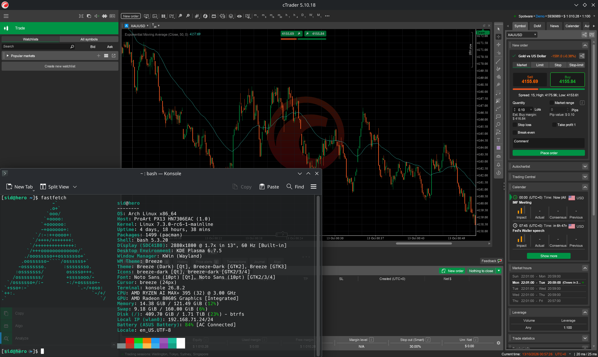

# cTrader Bottles Fix

Set up cTrader Desktop in Bottles on a Plasma Wayland session, using Xwayland for the application windows.



## Repository layout

```text
.
├── README.md
├── ctrader-desktop-on-linux.png
├── presets/
│   └── ctrader.yml
├── registry/
│   ├── ctrader-windowmetrics-fix.reg
│   └── ctrader-wpf-software.reg
├── scripts/
│   ├── build-overlay-helper.sh
│   └── overlay-helper.py
├── src/
│   └── notification-clickthrough.c
└── build/
```

## Bottles setup

1. Use Bottles' import feature to import [`presets/ctrader.yml`](presets/ctrader.yml) as a **configuration backup**. This creates a new `cTrader` bottle: Application, 64-bit, Windows 10, 144 DPI, Xwayland, and Microsoft GDI+.
2. Check that **gdiplus** is installed under **Dependencies** and its DLL override is `native,builtin`.
3. Install cTrader Desktop in the new bottle.
4. If the window dimensions are abnormal, apply the **Window dimensions** correction below.
5. Build and install the helper following **Automatic overlay fix**.
6. Start cTrader and check controls in the main window and Market Replay, including when the windows are maximized.

The preset recreates Bottles settings and listed dependencies. cTrader, the Wine registry, and the overlay helper are installed separately. Bottles may substitute available runner/component versions if the specified ones are missing.

For an existing bottle, use the settings in **Verified configuration**, install **gdiplus**, and install the helper.

## Window dimensions

Excessive `CaptionHeight`, `MenuHeight`, and `SmCaptionHeight` values under `HKEY_CURRENT_USER\Control Panel\Desktop\WindowMetrics` can cause incorrect window dimensions. If they are abnormal, export that registry key through **Registry Editor → File → Export**, then import [`registry/ctrader-windowmetrics-fix.reg`](registry/ctrader-windowmetrics-fix.reg) through **File → Import**.

| String value (`REG_SZ`) | Correct size |
| --- | ---: |
| `CaptionHeight` | `18` |
| `MenuHeight` | `18` |
| `SmCaptionHeight` | `17` |

Close cTrader normally and stop all processes in the bottle to reload the settings. To undo the correction, import the previously exported key.

## Microsoft GDI+

Microsoft GDI+ avoids UI freezes and abnormal memory growth caused by `System.Drawing.Common` calls to Wine's implementation. The **gdiplus** dependency installs the 32-bit and 64-bit DLLs and sets `gdiplus = native,builtin` under:

```text
HKEY_CURRENT_USER\Software\Wine\DllOverrides
```

## Popup notifications

cTrader uses a separate window for popups, with a `HwndWrapper[...]` class containing `Popup Notifications Thread`. In Wine, this window can remain visually transparent while intercepting clicks intended for the controls underneath. The blocked area follows the overlay's position on the screen: moving a control outside that area makes it clickable again.

Disabling popups does not always remove the overlay, including in Market Replay. The `WS_EX_TRANSPARENT` flag makes this layered window transparent to input; it must be reapplied whenever the window is recreated.

## Automatic overlay fix

[`src/notification-clickthrough.c`](src/notification-clickthrough.c) builds a 64-bit Windows program that checks windows every second. It only modifies layered windows owned by `cTrader.exe` whose class contains `HwndWrapper[` and `Popup Notifications Thread`, adding `WS_EX_TRANSPARENT` while preserving the other flags.

Popups remain visible, but their buttons and links become non-clickable: clicks pass through to the windows underneath.

### Build

Requires **MinGW-w64 GCC**, or **Clang + LLD** with Wine development headers and libraries.

```bash
bash scripts/build-overlay-helper.sh
```

The output is `build/ctrader-overlay-fix.exe`. For Clang builds, the default paths are `/usr/include/wine/windows`, `/usr/include/wine/msvcrt`, and `/usr/lib/wine/x86_64-windows`. Override them with `WINE_INCLUDE_DIR`, `WINE_CRT_INCLUDE_DIR`, and `WINE_LIB_DIR`.

### Installation with native Bottles

Set the paths to the bottle and its runner:

```bash
PREFIX="$HOME/.local/share/bottles/bottles/cTrader"
WINE="$HOME/.local/share/bottles/runners/RUNNER_NAME/bin/wine"

python3 scripts/overlay-helper.py install --prefix "$PREFIX" --wine "$WINE"
```

The script copies the program to `C:\tools\cTraderOverlayFix\ctrader-overlay-fix.exe`, starts it, and registers `cTraderOverlayFix` under `HKEY_LOCAL_MACHINE\Software\Microsoft\Windows\CurrentVersion\RunServices` in both the 32-bit and 64-bit registry views. This key is also processed by `wineboot -i`, which Bottles uses. Installation does not require `sudo`.

Only one instance stays active in the session, even when cTrader is closed. **Stop all processes in the bottle** also stops the helper; the next Wine session starts it again.

With Bottles Flatpak, the runner must execute inside its sandbox: the host installation script is intended for native Bottles. Copy the PE executable to the same Windows directory inside the bottle and register it under the same key using the bottle's Registry Editor.

### Start, stop, and uninstall

```bash
python3 scripts/overlay-helper.py start --prefix "$PREFIX" --wine "$WINE"
python3 scripts/overlay-helper.py stop --prefix "$PREFIX" --wine "$WINE"
python3 scripts/overlay-helper.py uninstall --prefix "$PREFIX" --wine "$WINE"
```

`uninstall` stops the helper and removes the executable and its autostart entry. After `stop` or `uninstall`, close and reopen cTrader normally to recreate the overlays with their original styles.

## Text size

On high-resolution displays, set **Custom DPI** to **144** (150%) in the bottle's **Settings → Display**. Close cTrader and stop all processes in the bottle before restarting it. For 200% scaling, use **192 DPI**.

Keep **Wayland (Experimental)** disabled. If you edit the configuration with external tools, close Bottles first and reopen it afterward so the GUI reloads the saved values.

## Verified configuration

| Component | Configuration |
| --- | --- |
| Operating system | Arch Linux |
| Desktop session | Plasma Wayland |
| Bottles | `67.4`, native package |
| Bottle | Application, `win64` |
| Runner | `soda-11.0-10` |
| Configured Windows version | Windows 10 |
| cTrader Desktop | `5.10.18` |
| DXVK | Enabled, `3.1.1` |
| GDI+ | Microsoft, `1.1.7601.17514`, override `native,builtin` |
| Wayland (Experimental) | Disabled; application uses Xwayland |
| Virtual desktop | Disabled |
| Custom DPI | `144` (150%) |
| WPF rendering | Hardware-accelerated; `DisableHWAcceleration` value absent |
| cTrader popup notifications | Optional; the helper fixes the overlay |
| Overlay fix | Automatic `ctrader-overlay-fix.exe` helper |

### Runner dependency on Arch

For native Bottles on Arch, the Soda runner requires `lib32-glibc`, which provides the 32-bit loader. Without it, bottle creation can fail with `/lib/ld-linux.so.2: could not open`:

```bash
sudo pacman -S --needed lib32-glibc
```

## Optional workaround for graphics crashes

For crashes in `d3d9.dll`/DXVK, try [`registry/ctrader-wpf-software.reg`](registry/ctrader-wpf-software.reg), which enables WPF software rendering by setting `DisableHWAcceleration=1` under `HKEY_CURRENT_USER\Software\Microsoft\Avalon.Graphics`. The working configuration uses WPF hardware acceleration.

To undo the workaround, delete that value and restart the bottle's processes.
